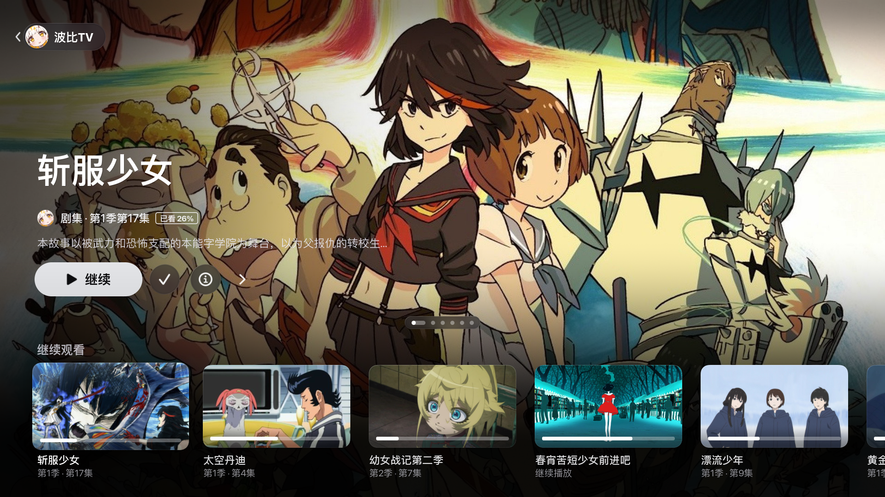

<h1 align="center">波比 TV</h1>

给电视大屏用的 Kodi 影院

  <a href="https://github.com/2223M1/bobbi-tv/releases/latest">下载</a> ·
  <a href="#功能">功能</a> ·
  <a href="#安装与上手">安装与上手</a> ·
  <a href="#日常使用">日常使用</a> ·
  <a href="https://github.com/2223M1/bobbi-tv/issues">反馈</a>

波比 TV 是一套跑在 Kodi 21 上的大屏影院界面。它把电影、剧集、动漫和你自己的 Emby、网盘、NAS 和本地硬盘收进同一个界面里，致力于打造流媒体体验的本地高画质影音系统。

目前主力维护 **CoreELEC / Kodi 21** 版本，免 SSH，也不用刷系统。

## 功能

- **大屏海报墙与自定首页** 热门电影、剧集、当季新番、动漫电影和自己的片库都在首页，8 个栏目随时隐藏或调顺序，还带一个默认关闭的液态玻璃开关。
- **Emby 在线片库** 直接连自己的 Emby 浏览海报、搜片和选季集，不用在盒子上把整库同步一遍。支持多账号切换和进度双向同步，另外也能连 Jellyfin 和 Plex。
- **网盘与本地片库** 支持 115 扫码登录、本机 CD2 挂载、SMB、NFS、WebDAV、本机和 U 盘目录、直链片库，以及 10 类原生多网盘接入（目前已实测 115 和百度网盘）。
- **源库** 支持导入标准 T4 站点和兼容源库网址，用 Kodi 原生目录翻分类、筛选、搜索和选集。
- **手动选源与原片直放** 同一部片子把不同片源列在一起自己挑，个别来源超时可以原地补查。选好直接交给 Kodi 原码流播放。
- **字幕、音轨与继续观看** 支持自动和手动找中文字幕、切音轨、调延迟。首页记着看到哪一集，剧集按同一发行版本接着往后找下一集。
- **手机扫码管理** 电视上扫个局域网二维码就能在手机浏览器里批量整理片库、传 T4 配置文件、管 Stremio 扩展或上传外挂字幕。

## 安装与上手

去 [GitHub Releases](https://github.com/2223M1/bobbi-tv/releases/latest) 下载最新的 **CoreELEC 完整安装包**（文件名以 `script.bobbi.start-` 开头）。留着 ZIP 别解压，直接丢进 U 盘或盒子能读到的目录。页面最底下的 `Source code` 源码包装不上，别下错。国内访问不便也可以看 [GitCode 镜像](https://gitcode.com/BobbiZerri/bobbi-tv-updates/releases)，以页面上的实际版本号为准。

1. 打开 Kodi，进 **插件 → 从 ZIP 文件安装**，选中刚下好的 ZIP。第一次装按提示开未知来源，等依赖装完。
2. 打开程序插件 **波比 TV · 开始使用**，按提示确认安装。中途 Kodi 问是否保留临时皮肤，选 **是**。
3. 装完会自动进到 **影院设置**。用 115 就扫码登录，用 Emby、CD2、NAS、WebDAV、T4 或本机目录就进 **我的片库 → 添加来源** 配一下，完事点 **进入波比影院**。
4. 按提示确认皮肤并重启一次 Kodi，回来挑一部片子就能直接看。

BT 播放是可选项，需要的话在 **影院设置 → BT 播放（可选）** 里装一下本机后台就行，只看网盘、Emby 或本地可以跳过。

## 日常使用

- **整理片库与手机配对** 在网盘或本地目录里把文件夹加入片库，去 **我的片库 → 片库索引与任务** 就能配海报和季集，不改原文件。需要批量操作时在电视上开 **手机详细管理** 扫码，关掉二维码窗口就会断开。
- **小雅 / TVBox（T4）** 支持填订阅网址、读本地 JSON 或手机扫码上传。配置里带的直播订阅可以顺手导出成 M3U8 给其他直播插件用。
- **外观与首页栏目** 进 **设置 → 外观与交互** 可以隐藏或调整首页 8 个栏目的顺序，也能开减少动效、顶部胶囊导航、非 HDR 转 SDR 和 **液态玻璃**（AM6B+ 原厂 CoreELEC 21.3 开启并重启后支持实时折射）。
- **多账号与 115 读取** Emby 可以同时登多个账号，在媒体服务器管理里随时切换首页默认浏览账号，切号不影响正在播的片子。115 可以在 **网盘账号与 CD2 → 详细管理** 里切换整块读取或边下载边读取，重启 Kodi 生效。
- **更新、回退与诊断** 停播后进 **影院设置 → 更新与恢复 → 检查波比 TV 更新** 就能在线升级。用不顺手可以在 **本地安装与版本恢复** 里退回上一版，账号、片库和观看记录都留着，想换回 Kodi 原皮肤选 **返回 Kodi 界面** 就行。**检查与诊断** 里默认开了轻量系统优化回传（只记版本和步骤耗时，不传日志、片名和账号），不想传随时关掉。

## 反馈

碰到问题欢迎提 [Issue](https://github.com/2223M1/bobbi-tv/issues)，顺手写一下设备型号、Kodi 和波比 TV 版本、用的什么片源，贴报错文字或拍张照就行。

## 致谢

感谢波比梓狸伟大的构想与实现。
